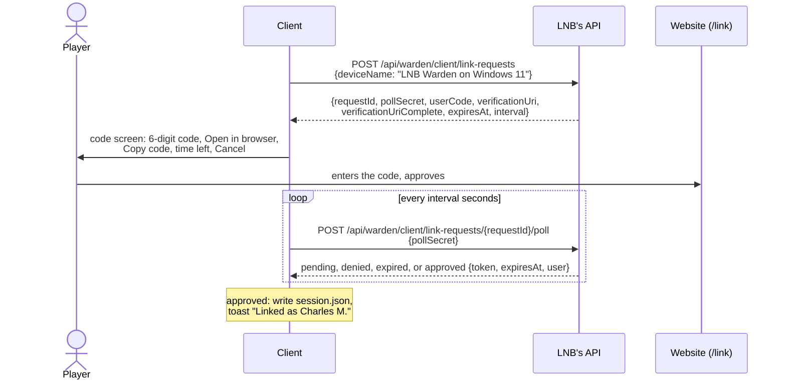
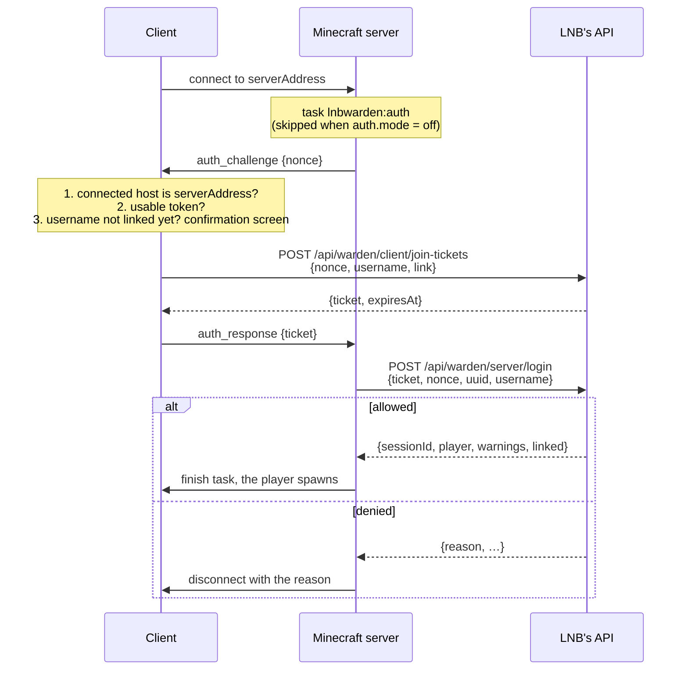

# Authentication

How LNB Warden ties players to their LNB account, on the client and on the server.

LNB's Minecraft server runs in offline mode ("cracked"): anyone can join with any username, and the UUID is derived
from the username (`UUIDUtil.createOfflinePlayerUUID`). A username therefore proves nothing. What proves who a player is
is a **device token** the mod gets by linking itself to an LNB account on the website. The server never sees that token:
on each connection the client trades it with LNB's API for a single-use **join ticket**, and the server checks the ticket.

The API side of this design is in LNB's API reference (`https://lnb.bde-teknantes.fr/api/docs`), under the
`Warden: clients` and `Warden: Minecraft server` tags.

## Overview

| Term                     | What it is                                                                                                                                              |
|--------------------------|---------------------------------------------------------------------------------------------------------------------------------------------------------|
| LNB account              | The player's account on the website. One per person.                                                                                                    |
| Device token             | Secret the mod receives once it is linked to an LNB account. Proves "this computer acts for that LNB account". Only ever sent to LNB's API, over HTTPS. |
| Linked Minecraft account | A username attached to an LNB account. One LNB account has several, up to a limit. A username belongs to at most one LNB account.                       |
| Nonce                    | 32 random bytes the server sends at each connection.                                                                                                    |
| Join ticket              | Single-use secret, valid 60 seconds, bound to one nonce and one username. The only credential that crosses the Minecraft connection.                    |

A player goes through three steps, the first two only once:

1. **Link the mod** to their LNB account: the mod shows a 6-digit code, the player enters it on the website.
2. **Link each Minecraft account** the first time they join with it: the mod asks for a confirmation, no code.
3. **Join**: the configuration task exchanges a nonce and a ticket, and the server asks the API whether to let the player in.

## Client

### Settings

Added to `ClientConfig` (`config/lnbwarden-client.toml`, also editable from the Mods screen):

| Key             | Default                        | Use                                                                                   |
|-----------------|--------------------------------|---------------------------------------------------------------------------------------|
| `apiUrl`        | `https://lnb.bde-teknantes.fr` | Base URL of LNB's API.                                                                |
| `serverAddress` | `mc.bde-teknantes.fr`          | Where the Multiplayer button connects, and the only host the client sends tickets to. |

### Device token storage

The token lives outside the game instance, so it survives modpack reinstalls, is shared by every instance and Minecraft
account of the OS user, and isn't included when someone zips or exports their instance. One LNB account per OS user.

| OS               | Directory                                                                           |
|------------------|-------------------------------------------------------------------------------------|
| Windows          | `%APPDATA%\lnbwarden\`                                                              |
| macOS            | `~/Library/Application Support/lnbwarden/`                                          |
| Linux and others | `$XDG_CONFIG_HOME/lnbwarden/`, or `~/.config/lnbwarden/` when unset or not absolute |

Pick the directory from `os.name` in one small function, falling back to `user.home`. The JVM property
`-Dlnbwarden.dataDir=<path>` overrides it, to test several accounts on one machine.

The file is `session.json`:

```json
{
  "version": 1,
  "apiUrl": "https://lnb.bde-teknantes.fr",
  "token": "lnbw_…",
  "expiresAt": "2027-01-20T21:00:00Z",
  "userId": "…",
  "name": "Charles M."
}
```

- Write it to a temporary file in the same directory, then move it over with `ATOMIC_MOVE`.
- On POSIX file systems, create the directory with `rwx------` and the file with `rw-------`. On Windows, `%APPDATA%` is
  already private to the user.
- Ignore the file when its `apiUrl` differs from the configured one: a token is only valid for the API that issued it.
- Delete the file when the API answers 401, and on sign-out.
- Never log the token, and keep it out of `toString()`. Log only `userId` and `name`.
- `expiresAt` is extended by the API while the token is used (90 days after the last use). Update the file when
  `GET /api/warden/client/me` returns a newer value.

### Linking the mod

Started from the main menu ("Link" button), and offered automatically at startup when there is no usable token.



"Open in browser" opens `verificationUriComplete` with `Util.getPlatform().openUri`. Poll answers:

| Answer | Client does |
| --- | --- |
| `pending` | Keep waiting. |
| 429 | Add 5 seconds to the interval. |
| `denied` | "Link refused on the website", back to the menu. |
| `expired` | "Code expired", offer a new code. |
| `approved` | Write `session.json`, toast "Linked as `name`". |

`deviceName` is what the player sees in their device list on the website. Build it from the mod name and the OS name,
never the machine's hostname.

### Main menu

- The **Multiplayer** button connects straight to `serverAddress`. It stays enabled even without a token: the server
  decides whether linking is required (see `auth.mode`), and refuses the player with a clear message when it is.
- An LNB status widget is always visible on the title screen. Every state is shown, none is silent:

| State                | Shows                                                                     |
|----------------------|---------------------------------------------------------------------------|
| Not linked           | "Not linked to LNB" and a **Link** button                                 |
| Linking              | The code screen is open                                                   |
| Checking             | Spinner, while `GET /api/warden/client/me` runs at startup                |
| Linked               | Player's name, their linked Minecraft accounts, and the active ban if any |
| Token rejected (401) | "Your LNB link expired or was revoked" and a **Link** button              |
| API unreachable      | "LNB is unreachable" and a **Retry** button. The token is kept.           |

Startup sequence:

```
read session.json
if no usable token → state "Not linked", offer the link screen
else GET /api/warden/client/me
  200     → state "Linked", start presence
  401     → delete session.json, state "Token rejected"
  network → state "API unreachable", retry with backoff (10 s, 30 s, 1 min, then every 5 min)
```

### Presence

For the website's social feature, while the game is open and the player is not on LNB's server:

- `PUT /api/warden/client/presence {state: "menu"}` every 60 seconds. The API forgets it after 3 minutes, which covers
  crashes.
- `DELETE /api/warden/client/presence` when the game closes, with a 2-second timeout so it never delays shutdown.
- While the player is on LNB's server, the server's session already says so: stop sending presence and resume after
  disconnecting.

### Signing out

A **Sign out** button in the status widget calls `POST /api/warden/client/sign-out`, then deletes `session.json` whatever
the answer. Revoking the device from the website has the same effect at the next API call (401).

## Joining the server

Authentication runs as a NeoForge configuration task (`RegisterConfigurationTasksEvent`), so the player is checked before
they spawn. Clients without the mod never answer and are disconnected by the timeout.



### Payloads

Registered as configuration payloads in `WardenNetwork`. Bump `PROTOCOL_VERSION`.

| Payload | Direction | Fields |
| --- | --- | --- |
| `lnbwarden:auth_challenge` | server → client | `nonce`: 32 bytes from `SecureRandom` |
| `lnbwarden:auth_response` | client → server | either `ticket: String`, or `failure`: `NO_TOKEN`, `TOKEN_REJECTED`, `API_UNREACHABLE`, `UNTRUSTED_SERVER`, `LINK_DECLINED` |

The nonce goes to the API as base64url without padding.

### Client side of the task

On `auth_challenge`:

1. If the host the client connected to isn't `serverAddress` (case-insensitive), answer `UNTRUSTED_SERVER`. This stops
   another server running this mod from asking for tickets and replaying them on LNB's server.
2. If there is no usable token, answer `NO_TOKEN`.
3. Refresh `GET /api/warden/client/me`. If the current username isn't in `accounts`, show a confirmation screen:
   *"Link the Minecraft account **Steve** to your LNB account (Charles M.)? 2 of 3 accounts used."*
   **Link** sets `link: true`. **Cancel** answers `LINK_DECLINED`. When `limit.used == limit.max`, the screen says so
   and only offers Cancel.
4. `POST /api/warden/client/join-tickets {nonce, username, link}`. On 401, delete `session.json` and answer
   `TOKEN_REJECTED`. On a network error or a 5xx, answer `API_UNREACHABLE`.
5. Send the ticket.

The player's consent to link is carried by the ticket itself (`link: true`), so the server can't link an account on its
own.

### Server side of the task

The server waits up to 2 minutes for `auth_response` (the confirmation screen can take a while), then disconnects.

With a ticket, call `POST /api/warden/server/login` with the connection's UUID and username:

| Result                        | Server does                                                                                                                                                   |
|-------------------------------|---------------------------------------------------------------------------------------------------------------------------------------------------------------|
| `allowed`                     | Finish the task. Keep `sessionId` for this player. After spawn, show `warnings` in chat, and "Steve is now linked to your LNB account" when `linked` is true. |
| `denied: banned`              | Disconnect with the reason and the end date, or "permanent".                                                                                                  |
| `denied: linkedElsewhere`     | Disconnect: this username belongs to another LNB account.                                                                                                     |
| `denied: accountLimitReached` | Disconnect: limit reached, unlink an account on the website.                                                                                                  |
| `denied: notLinked`           | Disconnect: this username isn't linked. Only happens if it was unlinked between the client's check and the login.                                             |
| `denied: schoolNotAllowed`    | Disconnect with the reason.                                                                                                                                   |
| `denied: invalidTicket`       | Disconnect: authentication failed, try again. Log a warning.                                                                                                  |
| API unreachable or 5xx        | See `auth.mode` below.                                                                                                                                        |

With a `failure`:

| Failure            | Disconnect message                                                             |
|--------------------|--------------------------------------------------------------------------------|
| `NO_TOKEN`         | "Link the mod to your LNB account from the main menu."                         |
| `TOKEN_REJECTED`   | "Your LNB link expired or was revoked. Link the mod again from the main menu." |
| `API_UNREACHABLE`  | "LNB's API couldn't be reached from your computer. Try again in a moment."     |
| `UNTRUSTED_SERVER` | Not expected on LNB's server. Disconnect and log it.                           |
| `LINK_DECLINED`    | "You need to link this Minecraft account to play here."                        |

Disconnect messages use `Component.translatableWithFallback`, so they are readable even on a client without the mod's
language file. The client recognises these messages and adds a **Link** button to the disconnect screen when relevant.

## Server

### Settings

Added to `ServerConfig` (`config/lnbwarden-server.toml`, never sent to clients):

| Key         | Default    | Use                                         |
|-------------|------------|---------------------------------------------|
| `auth.mode` | `required` | `required`, `optional` or `off`, see below. |

The mode is read when each connection starts, never cached, so an edit applies to the next player who joins, without a
restart. `/lnbwarden auth mode <mode>` changes and saves it from the console or in game.

| Mode       | Behaviour                                                                                                                                                                                                                                                                                                                                                                                                    |
|------------|--------------------------------------------------------------------------------------------------------------------------------------------------------------------------------------------------------------------------------------------------------------------------------------------------------------------------------------------------------------------------------------------------------------|
| `required` | Every player must be allowed by the API. API unreachable: everyone is refused with "LNB's API is unreachable, try again in a moment".                                                                                                                                                                                                                                                                        |
| `optional` | Players with a ticket go through the API as above, and get a session. Players without one (no mod, `NO_TOKEN`, `LINK_DECLINED`…) join as guests, **unless** their username is linked to an LNB account (`GET /api/warden/server/players/{uuid}` returns 200): then they must authenticate, otherwise anyone could play under a linked name. API unreachable: everyone joins as a guest, with a chat warning. |
| `off`      | No configuration task, no API calls. For development and private test servers.                                                                                                                                                                                                                                                                                                                               |

Guests get a chat message after spawn saying they play as a guest, and why ("not linked", "LNB's API is unreachable"…).

### Sessions

- The login opens the session. Keep a `sessionId` per online player.
- On logout: `POST /api/warden/server/sessions/end {sessionId, reason}`, with `kicked` when the server disconnected the
  player and `quit` otherwise.
- Every 60 seconds: `POST /api/warden/server/sessions/heartbeat {sessionIds}`. Sessions in `unknown` were closed by the API
  (for example after an outage longer than 3 minutes): stop tracking them and log it, but don't kick the players. Kicks
  come from the event stream.
- Keep `GET /api/warden/server/events` open:
  - `kick`: disconnect the listed UUIDs with the reason (`banned` with its ban, `unlinked`, `deviceRevoked`).
  - `settings`: log the new settings.
  - Reconnect with `Last-Event-ID` and a backoff (1 s, doubling up to 30 s).

### Commands

`/lnbwarden status` also reports:

- the auth mode;
- the API state: last successful call, and last error with its time;
- the event stream: connected since, or disconnected since and why;
- the last heartbeat result and the number of tracked sessions.

`/lnbwarden auth mode <required|optional|off>` changes the mode.

## Making failures visible

No failure is silent. Where each one shows up:

| Failure                               | Player sees                                                            | Staff see                                                                                            |
|---------------------------------------|------------------------------------------------------------------------|------------------------------------------------------------------------------------------------------|
| No token or rejected token            | Status widget, disconnect message with a Link button                   | —                                                                                                    |
| API unreachable from the client       | Status widget with Retry, disconnect message                           | —                                                                                                    |
| API unreachable from the server       | Disconnect message (`required`), or guest warning in chat (`optional`) | Console warning once per outage and once at recovery, chat message to operators, `/lnbwarden status` |
| Event stream down                     | —                                                                      | Console warning, `/lnbwarden status`                                                                 |
| Heartbeat failing                     | —                                                                      | Console warning, `/lnbwarden status`                                                                 |
| Link refused or account limit reached | Link screen or disconnect message                                      | —                                                                                                    |
| `invalidTicket`, `UNTRUSTED_SERVER`   | Disconnect message                                                     | Console warning with the username                                                                    |

Console warnings for repeated errors are logged once per state change, not once per attempt.

## Threading

No HTTP call runs on the render thread or the server thread. Use `java.net.http.HttpClient.sendAsync`, then go back with
`Minecraft.getInstance().execute` on the client and `server.execute` on the server before touching game state or
finishing the configuration task.

## Security notes

- The device token is only sent to `apiUrl`, over HTTPS. It is valid only on `/api/warden/client/**`, not on the rest of
  the website.
- A ticket is useless once seen: it works once, for one nonce, for one username, for 60 seconds. Someone reading the
  unencrypted Minecraft traffic can't reuse it.
- An offline-mode connection is not encrypted. Someone able to intercept and modify traffic on the network can still take
  over a connection after it has been authenticated. Fixing that would need encryption on the Minecraft connection, which
  is out of scope.
- Premium accounts are not detected. Every account is an offline account derived from its username, on the server and
  on the website.
